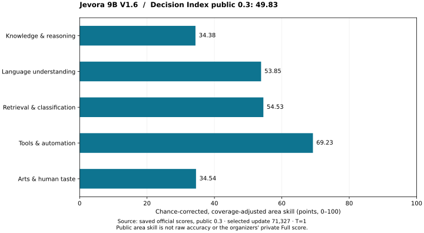
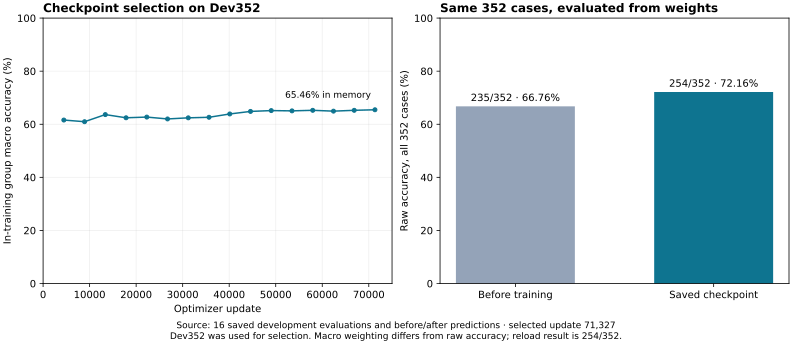

# Jevora 9B · V1.6

A decision model that reads a request and 2–255 ordered options, then returns
one choice and a probability for every option in a single forward pass.
The public interface is `POST /decision`: `context` and `options` in;
zero-based `choice` and ordered `probabilities` out.

[Benchmark adapter and reproduction contract](https://github.com/doxanocap/jevora-9b-v1/blob/main/docs/BENCHMARKS.md).

**V1.6 publication pending.** Training and Decision Index public evaluation are
complete for the selected research checkpoint. This README does not yet bind
a published V1.6 package revision or a real-weight public-loader check. The
working download below is explicitly the historical Full SFT V1 release; its
weights and temperature differ from V1.6.

- [Inference code](https://github.com/doxanocap/jevora-9b-v1)
- [Model repository](https://huggingface.co/kadirbekovvv/jevora-9b-v1)
- [Model card](https://github.com/doxanocap/jevora-9b-v1/blob/main/docs/MODEL_CARD.md)
- [Aggregate evidence](assets/v16-evidence.json)

## V1.6 results

| Measurement | Result | Scope |
| --- | ---: | --- |
| Decision Index public 0.3 | **49.83 points** | Chance-corrected, coverage-adjusted index (0–100) |
| Balanced raw score | 62.28 points | Weighted native scores; not ordinary case accuracy |
| Request coverage | 99.77% | 140,299 answered / 140,620; 321 unsupported, 0 errors |
| Development before training | 235/352 · 66.76% | Initialized decision system, same records |
| Development after saved-weight reload | 254/352 · 72.16% | Selection data, not an independent test |

### Similar-size decision models

Selected comparisons on **Decision Index Public**, in points (0–100):

| Model | Parameters | DI Public | Result source |
| --- | ---: | ---: | --- |
| GLiDE 9B | 7.94B | 68.77 | [Board](https://github.com/doxanocap/jevora-9b-v1/blob/main/docs/BENCHMARKS.md#model-comparison-sources) |
| Bespoke Nimble 9B v3 | 9.65B | 57.19 | [Board](https://github.com/doxanocap/jevora-9b-v1/blob/main/docs/BENCHMARKS.md#model-comparison-sources) |
| Sieve 9B v2 | 9.65B | 53.35 | [Board](https://github.com/doxanocap/jevora-9b-v1/blob/main/docs/BENCHMARKS.md#model-comparison-sources) |
| **Jevora V1.6** | **9.13B** | **49.83** | [Our saved run](assets/v16-evidence.json) |
| JPT-9B | 9.65B | 46.96 | [Board](https://github.com/doxanocap/jevora-9b-v1/blob/main/docs/BENCHMARKS.md#model-comparison-sources) |
| vLLM-SR Decision 2.0 Lux 9B | 9.65B | 46.76 | [Board](https://github.com/doxanocap/jevora-9b-v1/blob/main/docs/BENCHMARKS.md#model-comparison-sources) |

The pinned board snapshot was generated November 6, 2026. Its Public column
uses the same 37-benchmark 0.3 panel as our run, not the private Full 0.4 score.
Parameters are reported total/served counts rounded to billions, not trainable
counts. This is a descriptive cross-run comparison, not a controlled training
experiment or an official rank for Jevora. Exact sources and counting caveats
are in [BENCHMARKS](https://github.com/doxanocap/jevora-9b-v1/blob/main/docs/BENCHMARKS.md#model-comparison-sources).



*Figure 1. Five area aggregates from the saved official public 0.3 scores,
selected update 71,327, T=1. Area skill is chance-corrected and coverage-adjusted;
it is not accuracy. Sources and figure hashes: [aggregate evidence](assets/v16-evidence.json).*

These are our measured public-suite results for the saved research checkpoint.
They are not a private Full score or a claim of leaderboard acceptance.
The run uses the official 0.3 suite and scorer at
[`25c6ec7`](https://github.com/apolinario/decision-index/tree/25c6ec7b6b5f44a216c63c3a700de3a9c6d6699d).

## What changed

V1.6 starts from the post-trained `Qwen/Qwen3.5-9B` and trains rank-64 LoRA
adapters plus an LM-head-initialized decision head. The backbone is frozen.
174.2 million of 9.128 billion parameters are trainable. Backbone weights,
adapters and the decision head use BF16 storage.

Training used **570,616 presentations** from **380,411 records**, completing
**71,327 optimizer updates** at global batch 8 on one H100 PCIe. Peak allocated
GPU memory was 22.3 GiB. The model was selected using development performance.



*Figure 2. Left: 16 saved in-training evaluations, optimizer updates versus
group macro accuracy (%). Right: raw accuracy on the same 352 records before
training and after saved-weight reload, 235/352 and 254/352. Dev352 was used
for selection. Different weighting and execution states are shown separately;
this is not an independent final test.*

V1.6 uses **temperature 1 with no fitted calibration**. Higher development
accuracy did not improve probability quality:
NLL rose from 0.865 to 1.008. Model probabilities should not be treated as
calibrated confidence. Multi-step state transitions and instruction execution
remain weaknesses. The in-memory selected evaluation implied 256/352; the
saved-weight result is 254/352, with the difference confined to one development slice. The
cause is not established. [The card](https://github.com/doxanocap/jevora-9b-v1/blob/main/docs/MODEL_CARD.md) describes the weighting,
reload discrepancy and verification limits.

| Dev probability metric, T=1 | Before training | Saved-weight reload |
| --- | ---: | ---: |
| Mean NLL (nats; lower is better) | 0.8650 | 1.0076 |
| Multiclass Brier (lower is better) | 0.4297 | 0.4481 |
| ECE, 10 equal-width bins | 6.60% | 19.35% |

These describe the same 352 selection cases; they are not independent test
estimates or a fitted calibration result.

## From prototype to V1.6

The initial 0.6B experiments established that updates survived checkpoint
save/reload. The 4B stage added source-grounded decision tasks and exposed gaps
in close intents and inference. Earlier 9B runs explored Full SFT and separate
development, calibration and final sets. V1.6 expanded the corpus and used
LoRA for a complete run on one H100, followed by an external public benchmark.

This progression is a project history, not a controlled scaling comparison:
models, corpora and evaluation sets changed. It does not establish a causal
advantage of LoRA over Full SFT or of data volume alone.

## Inference scope

V1.6 accepts at most 8192 tokens after rendering the request and all options.
Oversized inputs are rejected rather than truncated. It is a text decision
model with a custom loader, not a standard chat/generation pipeline. No hosted
endpoint, vision support or generated reasoning trace is advertised.

The public repository contains inference code, documentation and aggregate
figures. Training data, raw predictions and private research tooling are not
included. [LICENSES.md](LICENSES.md) separates code/weight licensing from the
source datasets' own terms.

## Install and use

Use the public inference repository and its locked Python 3.13 environment:

```bash
git clone https://github.com/doxanocap/jevora-9b-v1.git
cd jevora-9b-v1
uv sync --locked
```

### Use a verified V1.6 package

Set `PACKAGE` to the verified local V1.6 package root supplied by the release
receipt, then run:

```bash
make verify-package PACKAGE="$PACKAGE"
make example PACKAGE="$PACKAGE" DEVICE=cpu
make serve PACKAGE="$PACKAGE" DEVICE=cuda
```

There is no implicit download or default model selection. An exact V1.6 Hub
revision will be added here only after its publication receipt is available.
The pinned download in the next section selects the older model deliberately.

### Historical V1 download

The download command retrieves the complete model repository into `MODEL_DIR`;
the loader is then given the package subdirectory explicitly.

```bash
HF_REPO_ID=kadirbekovvv/jevora-9b-v1
MODEL_DIR=./models/jevora-9b-v1
HF_REVISION=c644b9c7a3b67b7acc3279523e3bee69a4be473d

uv run --no-sync hf download "$HF_REPO_ID" --revision "$HF_REVISION" --local-dir "$MODEL_DIR"
make verify-package PACKAGE="$MODEL_DIR/jevora-9b-v1"
make example PACKAGE="$MODEL_DIR/jevora-9b-v1" DEVICE=cpu
make serve PACKAGE="$MODEL_DIR/jevora-9b-v1" DEVICE=cuda
```

Use a fresh `MODEL_DIR` for each revision; keep earlier downloads for rollback.
The published revision above remains usable independently of later releases.
The top-level repository files are documentation and licensing material; the verified model
package is exactly `MODEL_DIR/jevora-9b-v1`.
The historical BF16 weights are approximately 18 GB. Leave disk space for the
downloaded package and provide additional RAM or VRAM beyond the raw weight size; this
project does not claim a universal minimum.

The example and server commands run against the package you select, not a
default model revision. **The pinned package above is V1, not V1.6.**

`make serve` exposes `POST /decision` on `127.0.0.1:8080`. Its request is
`{"context": "...", "options": ["...", "..."]}`; its response is
`{"choice": 0, "probabilities": [0.7, 0.3]}`. Option order is semantic: the
returned `choice` is the zero-based index in the submitted array. The loader
rejects missing, modified or incomplete packages before weights are loaded.

Use `make api-check PACKAGE="$MODEL_DIR/jevora-9b-v1" DEVICE=cuda` for a
local HTTP contract check.
It validates a real loaded package, but does not call an external API.

### One decision

After `make serve`, submit one request from a second terminal:

```bash
curl -sS http://127.0.0.1:8080/decision \
  -H 'content-type: application/json' \
  -d '{"context":"Milo signed invoice 19.","options":["Milo signed invoice 19.","Milo signed invoice 18."]}'
```

The response contains a zero-based `choice` and a `probabilities` array in the
same order as the supplied options.

All task text, including the question, belongs in `context`. There is no
separate `question` field. Empty options, fewer than two or more than 255
options, and inputs beyond the package's rendered token limit are rejected.
The historical release limit is 1024 tokens, including options and prompt.
The local server supplies no authentication or hosted inference service.

### Versions and evidence

| Public version | Source run | Development | Independent final | Availability |
| --- | --- | --- | --- | --- |
| Historical V1 (Full SFT) | `9b-v1-full-g1-01`, selected step 4000 | 515/600 | 517/600 | Recorded historical HF revision pinned above |
| V1.6 (LoRA) | `train-a1`, selected step 71327 | 254/352 after reload | Not measured in this release evidence | Publication and real-weight package check not yet recorded here |

The source run is a historical training identifier. An experiment namespace
groups research artifacts; neither automatically defines a public model name.
Package format revisions describe serialization, not a new trained model.

## Model repository layout

The Hugging Face repository keeps public documentation and licensing material
outside the manifest-covered package:

```text
README.md                 # Hugging Face model card, license: apache-2.0
LICENSE
NOTICE
LICENSES.md
assets/                   # aggregate figures only
jevora-9b-v1/             # verified package root
  checkpoint/
  calibration.json
  inference-config.json
  manifest.json
  MODEL_CARD.md
```

Do not manually replace `MODEL_CARD.md` or another manifest-covered file
inside an assembled package: that makes its `manifest.json` invalid. Release
maintainers build and publish only with the private release tooling; it is not
part of this inference repository.

## Historical results and licensing

The historical Full SFT model had a separate 600-case development result of
515/600 and an independent final result of 517/600, with fitted temperature
1.7484084899282697. Those measurements use different records and a different
training recipe; they are not a before/after comparison with V1.6.
Historical figure hashes and their evidence limitations remain in
[assets/evidence.json](assets/evidence.json). The four historical SVG files are
retained for earlier release references and are not presented as V1.6 results.

[The model card](https://github.com/doxanocap/jevora-9b-v1/blob/main/docs/MODEL_CARD.md) describes architecture, training, source
identities and limitations. [BENCHMARKS](https://github.com/doxanocap/jevora-9b-v1/blob/main/docs/BENCHMARKS.md) describes the official
runner, metric denominators and reproduction inputs. No private Full score,
JevBench result or leaderboard rank is claimed.

[LICENSE](LICENSE) covers project code and derivative weights under Apache-2.0.
[LICENSES.md](LICENSES.md) and [NOTICE](NOTICE) preserve upstream attribution.
The inference release does not grant rights to redistribute the training
sources. This repository exports no raw predictions, training data, private
machine paths or full research reports.
