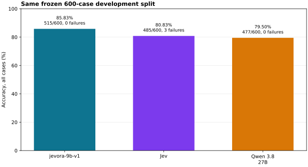
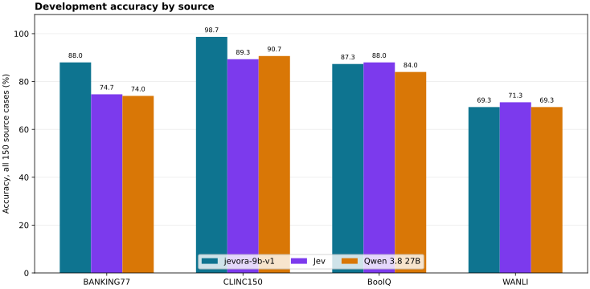
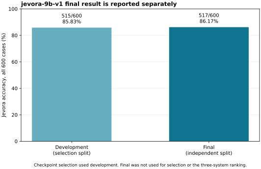
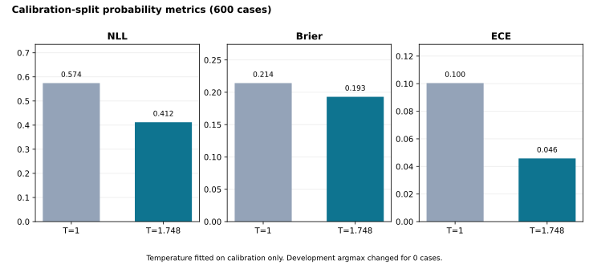

# jevora-9b-v1

`jevora-9b-v1` is an **open-weight research decision model**. Given one
model-visible context and 2–255 ordered options, it returns a zero-based choice
and a probability for every supplied option. Project code and derivative
weights are licensed under Apache-2.0. It is not a chat model, a general
text-generation API, or a claim that the closed research pipeline is published.

This Git repository contains the inference loader, local `/decision` server,
integrity verifier, example, locked runtime, documentation and aggregate result
figures. It intentionally excludes training code, corpora, evaluation records,
predictions, checkpoints, archives, caches and credentials. The release model
package was assembled and passed `api_check --package` with the existing
project runtime. This new minimal public loader has not yet been run against
that package. The Hugging Face repository is prepared but its first model
package upload remains an explicit owner action.

- Code and public documentation: [doxanocap/jevora-9b-v1](https://github.com/doxanocap/jevora-9b-v1)
- Model package: [kadirbekovvv/jevora-9b-v1](https://huggingface.co/kadirbekovvv/jevora-9b-v1)

## Quick start

The download command retrieves the complete model repository into `MODEL_DIR`;
the loader is then given the package subdirectory explicitly.

```bash
HF_REPO_ID=kadirbekovvv/jevora-9b-v1
MODEL_DIR=./models/jevora-9b-v1

uv sync --locked
uv run hf download "$HF_REPO_ID" --revision main --local-dir "$MODEL_DIR"
make verify-package PACKAGE="$MODEL_DIR/jevora-9b-v1"
make example PACKAGE="$MODEL_DIR/jevora-9b-v1" DEVICE=cpu
make serve PACKAGE="$MODEL_DIR/jevora-9b-v1" DEVICE=cuda
```

After the first upload, replace `main` in this command with the recorded,
immutable Hugging Face revision for reproducible downloads. The top-level
repository files are documentation and licensing material; the verified model
package is exactly `MODEL_DIR/jevora-9b-v1`.
The BF16 weights are approximately 18 GB. Leave disk space for the downloaded
package and provide additional RAM or VRAM beyond the raw weight size; this
project does not claim a universal minimum.

`make serve` exposes `POST /decision` on `127.0.0.1:8080`. Its request is
`{"context": "...", "options": ["...", "..."]}`; its response is
`{"choice": 0, "probabilities": [0.7, 0.3]}`. Option order is semantic: the
returned `choice` is the zero-based index in the submitted array. The loader
rejects missing, modified or incomplete packages before weights are loaded.

Use `make api-check PACKAGE="$MODEL_DIR/jevora-9b-v1" DEVICE=cuda` for a
local HTTP contract check.
It validates a real loaded package, but does not call an external API.

### One decision

After `make serve`, submit one request from a second terminal:

```bash
curl -sS http://127.0.0.1:8080/decision \
  -H 'content-type: application/json' \
  -d '{"context":"Milo signed invoice 19.","options":["Milo signed invoice 19.","Milo signed invoice 18."]}'
```

The response contains a zero-based `choice` and a `probabilities` array in the
same order as the supplied options.

## Model repository layout

The Hugging Face repository keeps public documentation and licensing material
outside the manifest-covered package:

```text
README.md                 # Hugging Face model card, license: apache-2.0
LICENSE
NOTICE
LICENSES.md
assets/                   # aggregate figures only
jevora-9b-v1/             # verified package root
  checkpoint/
  calibration.json
  inference-config.json
  manifest.json
  MODEL_CARD.md
```

Do not manually replace `MODEL_CARD.md` or another manifest-covered file
inside an assembled package: that makes its `manifest.json` invalid. Release
maintainers build and publish only with the private release tooling; it is not
part of this inference repository.

## Results

All three systems below received the same frozen 600-case development split.
Technical failures stay in the denominator. These are descriptive measurements,
not a statistical-superiority claim; the selected checkpoint was chosen on dev.

| System | Correct / 600 | Accuracy | Technical failures |
| --- | ---: | ---: | ---: |
| `jevora-9b-v1` | 515 | 85.83% | 0 |
| Jev | 485 | 80.83% | 3 |
| Qwen | 477 | 79.50% | 0 |





The independent final split is reported separately and is not ranked against
the development baseline.

The Qwen row is a project-specific descriptive comparison on these
frozen records, not an official Qwen benchmark.



Temperature was fitted only on the separate calibration split. It did not alter
development argmax choices; it improves probability quality metrics below.



See [the detailed model card](https://github.com/doxanocap/jevora-9b-v1/blob/main/docs/MODEL_CARD.md)
for the exact architecture, package format, evaluation boundary, limitations,
provenance and limitations. [LICENSE](LICENSE) applies Apache-2.0 to project
code and derivative weights; [LICENSES.md](LICENSES.md) separates
upstream and non-published components.
